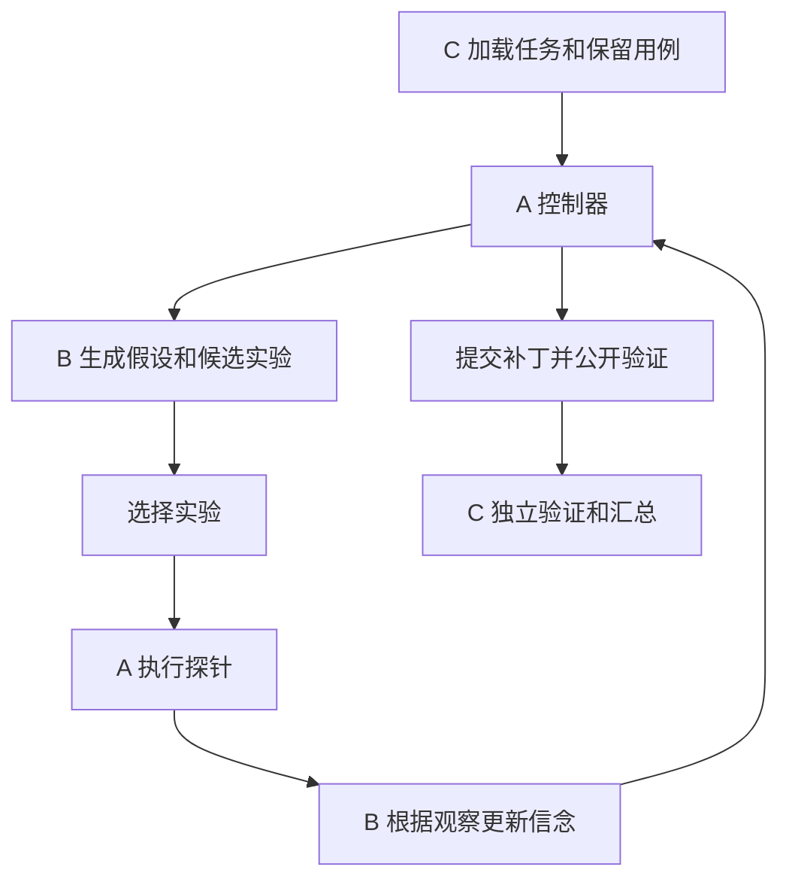

# ActiveDebugAgent

**基于多假设推理与成本敏感信息增益的 Coding Agent 主动调试系统**  

要研究的问题是：**给定相同计算预算，显式维护假设和选择实验能否提高故障定位准确率与独立修复成功率？** 

## 五分钟演示

从仓库根目录运行，需要 Python 3.11 或更高版本。离线即可执行：

```sh
PYTHONPATH=src python3 -m active_debug --strategy hypothesis_eig
python3 scripts/smoke_test.py
PYTHONPATH=src python3 -m unittest discover -s tests -v
```

第一条命令运行单种策略。第二条分别执行四种策略。CLI 输出最终 JSON，独立验证通过时退出码为 0，验证失败时为 1。每次运行在 results/ 生成独立的 JSONL。示例函数应返回输入的两倍，公开输入 3 的实际输出为 5。观察 prior、probe 对应的 response 和 update，即可复盘哪个假设失去支持。

常规开发安装（需要软件源或已缓存的开发依赖）：

```sh
python3 -m venv .venv
source .venv/bin/activate
python -m pip install -e '.[dev]'
python -m pytest -q
active-debug --task examples/simple_bug --config configs/default.toml --output results
```

默认 Provider 为 Mock，无需密钥。后续真实 Provider 从环境变量读取密钥，禁止把密钥写入配置、提示日志或版本库。

## 架构



C 只向控制器传公开任务。A 掌握调用预算、Provider 与执行器。B 的算法只接收数据，执行权限集中到 A。公共契约由三人共同维护。

## 分工与交接

### 成员 A · Agent 框架与系统集成

A 负责让四种策略通过同一入口运行。先接通模型调用、补丁应用和公开测试，完成直接修复与自由调试两种基线。接入主动诊断时，A 把公开失败交给 B，通过 `run_experiment` 执行 B 选出的实验，再把实际输出、退出码和超时信息交回 B。诊断结束后，A 通过 `apply_patch` 和 `verify_patch` 应用并检查补丁，将最终候选交给 C 独立验证。

A 向团队交付可从 CLI 启动的运行器，以及能够逐次核对模型和工具调用的日志。验收时，构造超时、无效补丁和预算耗尽三种情况，分别检查执行结果能否标记超时、原候选源码是否保留、达到上限后是否停止调用。后续由 A 实现检查点和状态恢复。

**需要修改的文件**（Agent 模块位于 `src/active_debug/agent/`）：优先从 `llm_client.py` 接入真实 Provider，再按任务修改 `agent.py`、`baseline.py`、`debug_controller.py`、`tool_executor.py` 和 `trace_logger.py`。入口与验收涉及 `src/active_debug/cli.py`、`scripts/smoke_test.py`、`tests/test_agent.py` 和 `tests/test_integration.py`。

### 成员 B · 故障假设与主动诊断

B 负责回答两个问题：哪些原因能解释当前错误，下一次实验能区分哪些原因？从 A 提供的 `FailureTrace` 出发，B 生成候选假设，为每个实验写出各假设对应的预测结果，并计算预期信息增益与成本。A 执行实验后，B 用实际观察更新置信度和实验历史，通过 `DiagnosisState` 将结果交回 A。开发时使用 C 提供的公开开发样例。

B 先交付可单独测试的假设生成器与选择器，再接入信念更新和停止条件。验收时，用两个等概率假设手算一组实验：两者预测相同的实验收益为 0 bit，能够完全区分两者的实验收益为 1 bit。再检查提高实验成本是否会改变选择、更新后的概率之和是否为 1，以及无法解释的观察是否被记录。

**需要修改的文件**（诊断模块位于 `src/active_debug/diagnosis/`）：优先扩展 `hypothesis_generator.py`，其余职责对应 `hypothesis_manager.py`、`experiment_generator.py`、`experiment_selector.py`、`belief_updater.py` 和 `stopping_policy.py`。算法测试写入 `tests/test_diagnosis.py`；若需调整共享数据模型，与 A、C 协商后同步修改 `src/active_debug/schemas.py` 和 `docs/interfaces.md`。

### 成员 C · 测试数据与实验评估

C 负责任务加载、独立验证和结果汇总。先把一个故障整理成两部分：A 可以读取的源码与公开失败用例，以及仅由评估端持有的保留用例与定位标签。再通过 A 的统一入口，让四种策略从相同源码和预算开始运行，由同一验证器检查最终候选。C 可根据运行结果统计修复成功率、行动次数和耗时，无需读取 B 的内部状态。

C 先交付可复现的任务和验证器，再接入数据集适配与配对统计。验收时，提交一个只会返回公开样例答案的补丁，确认它能通过公开测试，却会被独立验证拒绝。同时检查公开输入与保留输入是否重叠，并确认预算耗尽的运行也有结果记录，可进入汇总。

**需要修改的文件**（评估模块位于 `src/active_debug/evaluation/`）：优先从 `dataset_loader.py` 接入首个真实任务，再按任务修改 `task_filter.py`、`benchmark_runner.py`、`patch_validator.py`、`metrics.py` 和 `statistical_analysis.py`。示例任务、验收测试和实验口径分别维护在 `examples/simple_bug/task.json`、`tests/test_evaluation.py` 和 `docs/experiment_protocol.md`。

## 协作规范

- 分支使用 feature/agent-*、feature/diagnosis-*、feature/evaluation-*。按一项可验收变更发 PR，附测试命令、输入、预期观察与实际输出。
- 至少一名非作者审查后合并。共享 schema 或预算语义变更先开 issue，附前后示例并通知另外两人；由受影响模块负责人确认后，同一 PR 更新调用方、契约测试与 docs/interfaces.md。
- 各人维护所属模块的正常、错误和边界用例。每周五共同跑 pytest 与四策略 smoke，记录阻塞项、负责人和下周接口需求。
- 遇到模块冲突先用最小失败用例复现。字段语义由三人共同确定，各负责人修复自身模块，A 负责联合回归后合并。

